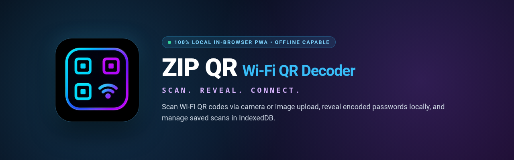
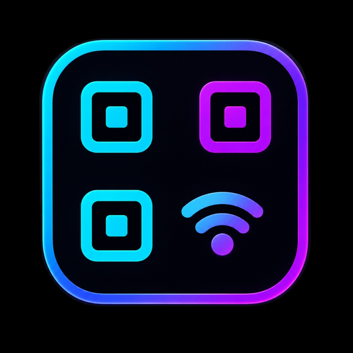
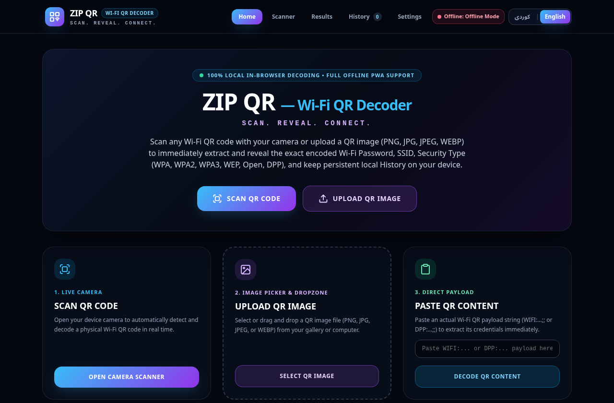
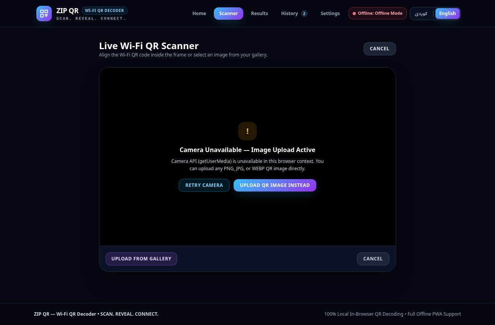
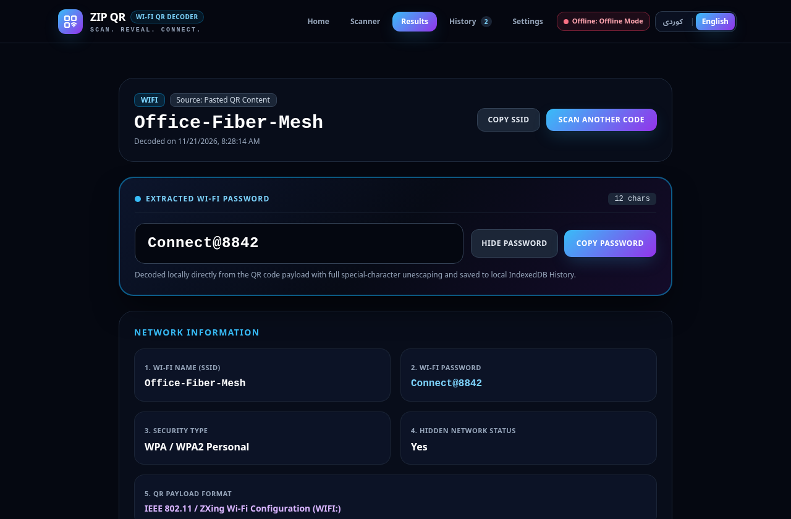
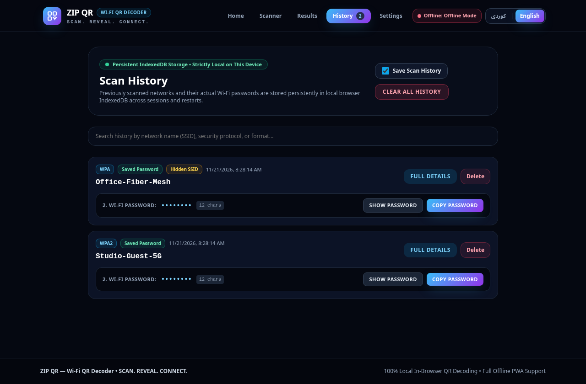

<div align="center">



<br />
<br />



<h1>ZIP QR</h1>
<h3>Wi-Fi QR Decoder</h3>
<p><strong><code>SCAN. REVEAL. CONNECT.</code></strong></p>

<p>
  Scan Wi-Fi QR codes, instantly reveal network details, and manage your saved networks — all on your device.
</p>

<br />

<p>
  <a href="https://github.com/ZIP-2018/ZIP-QR-WIFI-DECODER/releases/latest/download/ZIP-QR-WIFI-DECODER.zip">
    
  </a>
  &nbsp;&nbsp;&nbsp;
  <a href="https://zip-wifi-qr-decoder.pages.dev/">
    
  </a>
</p>

<p>
  <sub>
    One-click Release archive: <a href="https://github.com/ZIP-2018/ZIP-QR-WIFI-DECODER/releases/latest/download/ZIP-QR-WIFI-DECODER.zip"><code>ZIP-QR-WIFI-DECODER.zip</code></a>
    &nbsp;&bull;&nbsp;
    Live App: <a href="https://zip-wifi-qr-decoder.pages.dev/"><code>zip-wifi-qr-decoder.pages.dev</code></a>
    &nbsp;&bull;&nbsp;
    <a href="LICENSE">MIT License</a>
  </sub>
</p>

</div>

---

## Project Overview

**ZIP QR** is a browser-based Progressive Web Application that decodes Wi-Fi QR codes (`WIFI:...` and Wi-Fi Easy Connect `DPP:...`) locally on your device. Most built-in phone cameras connect to a Wi-Fi QR code without showing the password or full configuration details. ZIP QR extracts and displays the exact SSID, Wi-Fi password, security protocol, hidden network flag, and additional encoded fields so you can inspect, copy, or revisit them across mobile and desktop devices without installing native software or creating an account.

This repository is the public presentation and distribution page for ZIP QR. The complete, ready-to-build project archive (`ZIP-QR-WIFI-DECODER.zip`) is distributed through GitHub Releases for one-click downloading.

---

## Key Features

| Feature | Capability |
| :--- | :--- |
| **Multi-Stage QR Recognition** | Combines native `BarcodeDetector` support with a local computer-vision pipeline featuring de-moiré smoothing, adaptive local thresholding, finder-pattern triad localization, perspective homography, and Reed-Solomon error correction. |
| **Live Camera Scanning** | Scans physical Wi-Fi QR codes in real time with automatic rear-camera selection and hardware-detected flashlight (torch), zoom, and camera switching controls. |
| **QR Image Upload & Payload Paste** | Decodes uploaded `PNG`, `JPG`, `JPEG`, and `WEBP` images (including multi-QR detection) as well as directly pasted `WIFI:` and `DPP:` payloads. |
| **Wi-Fi Credential Extraction** | Extracts SSID, exact Wi-Fi password (with escaped special-character and Unicode support), security type (`WPA`, `WPA2`, `WPA3`, `WEP`, `Open`, `DPP`), hidden network status, and raw payload content. |
| **Password Reveal & Copy** | Displays extracted passwords clearly with one-click copy, show/hide masking, and `.TXT` / `.JSON` report download for individual scans. |
| **Persistent Local History** | Saves decoded networks and their Wi-Fi passwords in browser-local `IndexedDB` with search, masked password display (`••••••••`), per-entry reveal/copy controls, single-entry deletion, and clear-all controls. |
| **Kurdish Sorani & English Interface** | Full bilingual localization supporting Kurdish Sorani (RTL) and English (LTR) with instant switching in the header and Settings. |
| **Installable Offline PWA** | Installable on supported Android, iOS, iPadOS, Windows, macOS, and Linux devices with Service Worker caching for offline operation. |
| **Client-Side Local Processing** | Performs QR decoding and Wi-Fi payload parsing directly in the browser with no login or account required. |

---

## Application Screenshots

> *All screenshots show authentic views of the ZIP QR interface using safe synthetic demonstration network names and passwords.*

<table>
  <tr>
    <td align="center" width="50%">
      
      <br />
      <strong>Home / Main Interface</strong><br />
      <sub>Direct access to Live Camera Scan, QR Image Upload, and Paste QR Content.</sub>
    </td>
    <td align="center" width="50%">
      
      <br />
      <strong>QR Scanner</strong><br />
      <sub>Real-time camera scanning interface with gallery upload fallback and hardware controls.</sub>
    </td>
  </tr>
  <tr>
    <td align="center" width="50%">
      
      <br />
      <strong>Scan Results</strong><br />
      <sub>Prominent extracted Wi-Fi password with copy, reveal/hide, and full network details.</sub>
    </td>
    <td align="center" width="50%">
      
      <br />
      <strong>History</strong><br />
      <sub>Searchable local IndexedDB scan history with masked passwords and per-entry actions.</sub>
    </td>
  </tr>
</table>

---

## How to Use

1. **Open ZIP QR** at [https://zip-wifi-qr-decoder.pages.dev/](https://zip-wifi-qr-decoder.pages.dev/) in your mobile or desktop browser.
2. **Scan or Upload a Wi-Fi QR Code** using **Scan QR Code** (live camera), **Upload QR Image** (`PNG`, `JPG`, `JPEG`, `WEBP`), or **Paste QR Content**.
3. **Review the Decoded Network Information** on the Results screen, including the network name (SSID), security type, and hidden status.
4. **Reveal or Copy the Password** using the password card controls.
5. **Access Saved Scans in History** anytime to search, reveal, copy, or delete previously decoded networks.

---

## PWA and Offline Support

ZIP QR is a **Progressive Web Application (PWA)** that can be installed on supported phones, tablets, and computers for a standalone app experience.

After your first successful online visit and once the Service Worker finishes caching all essential application files, the core features—camera scanning, QR image upload decoding, Wi-Fi credential extraction, History access, language switching, and Settings—can work offline.

**Important Considerations:**
- Initial loading and asset caching require an internet connection.
- Checking for and installing application updates require an internet connection.
- Camera access requires `HTTPS`, granted camera permissions, and browser support.
- Local browser storage and cached assets can be cleared by the user or browser storage policies.
- Offline readiness depends on all essential application files being successfully cached.

---

## Privacy and Data Storage

- **Local QR Decoding:** QR image decoding, camera frame processing, and Wi-Fi payload parsing happen locally inside your browser.
- **No External Credential Uploads:** Uploaded images, camera frames, decoded QR contents, and Wi-Fi passwords are not sent to external services by the application.
- **Normal Static Hosting Requests:** Standard `HTTPS` requests to the hosting origin are still required to load application files and receive updates.
- **Local IndexedDB Storage:** Saved scans and Wi-Fi passwords are stored locally in your browser's `IndexedDB` (`zip_qr_local_db`), subject to standard browser storage quotas and policies. Local browser storage is **not automatically encrypted**—while passwords are masked (`••••••••`) in the History interface, anyone with direct access to the same unlocked browser profile on your device can inspect saved local data.

---

## Installation and Development

Download [`ZIP-QR-WIFI-DECODER.zip`](https://github.com/ZIP-2018/ZIP-QR-WIFI-DECODER/releases/latest/download/ZIP-QR-WIFI-DECODER.zip) from the latest GitHub Release and extract it. The archive extracts into a single `ZIP-QR-WIFI-DECODER/` folder. `node_modules/` is intentionally excluded; install dependencies via `npm`.

### Commands

```bash
unzip ZIP-QR-WIFI-DECODER.zip
cd ZIP-QR-WIFI-DECODER
npm ci
npm test
npm run build
```

*(Automated image-synthesis tests in `npm test` require Python with `opencv-python`, `pillow`, and `numpy`. Run `npm run dev` to preview the built `dist/` bundle locally.)*

### Production Build Architecture

`npm run build` executes `node scripts/buildDist.cjs`, a deterministic Node.js static builder that compiles and content-hashes the active production files into `dist/`:

- `src/templates/body.html` — Active HTML application layout
- `src/templates/app.css` — Active self-contained stylesheet
- `src/templates/runtime.js` — Active client-side runtime (QR decoder, Wi-Fi parser, camera controller, IndexedDB History, i18n, and UI controller)
- `public/` — PWA `manifest.json`, `sw.js`, Cloudflare `_headers` and `_redirects`, favicons, Apple Touch Icons, and standard/maskable icons
- `scripts/buildDist.cjs` — Production static bundler

---

## Technologies

ZIP QR's active production application is built with:

- **HTML5, CSS3, and JavaScript** (zero external CDN scripts or third-party fonts)
- **HTML5 Canvas API & Local Computer Vision** (native `BarcodeDetector` where supported, plus local adaptive binarization, finder triad localization, perspective homography, and Reed-Solomon error correction)
- **Browser MediaDevices Camera API** (`getUserMedia`, hardware torch and zoom controls)
- **IndexedDB & Web Storage** (browser-local History and preferences persistence)
- **Progressive Web App APIs** (Web App Manifest, Service Worker, Cache Storage API)
- **Node.js Static Build & Automated Test Runner** (`scripts/buildDist.cjs`, `tests/runTests.cjs`, and compiled CommonJS test modules)

---

## Created & Developed By

**Zardasht Muhammad**  
Creator & Developer of ZIP QR  
Email: [zardashtmuhammad12@gmail.com](mailto:zardashtmuhammad12@gmail.com)

---

## License

ZIP QR is distributed under the **MIT License**. See the [`LICENSE`](LICENSE) file for details.

Third-party dependencies retain their respective licenses and copyright notices. The MIT License applies to the software source code and does not grant permission to use the **ZIP QR** name or official logo as a trademark.
